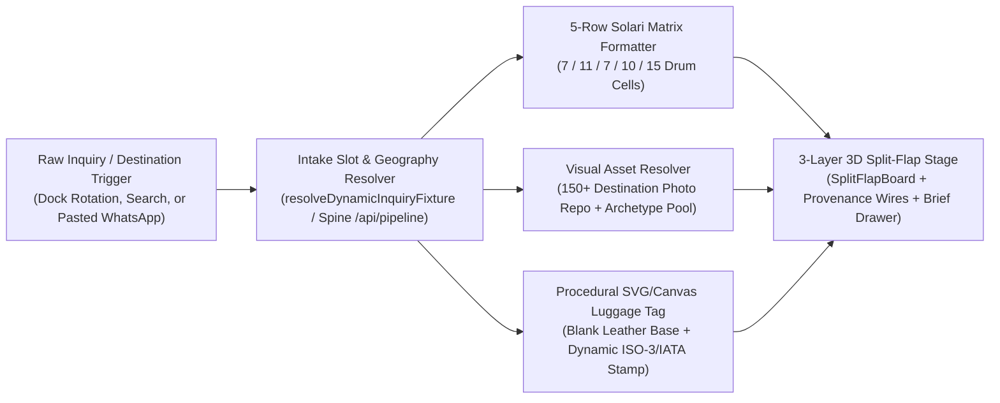

# Dynamic Departure Board & Large Visual Asset Catalog Architecture

**Date:** 2026-11-04  
**Scope:** Waypoint B2B Landing Page (`/`, `/landing/departure-board`) & Interactive Advisor Intake Preview  
**Related Files:**
- [`frontend/src/components/marketing/departure-board/board-fixtures.ts`](file:///Users/pranay/Projects/travel_agency_agent/frontend/src/components/marketing/departure-board/board-fixtures.ts) (`DESTINATION_CATALOG_REGISTRY`, `resolveDynamicInquiryFixture`)
- [`frontend/src/components/marketing/departure-board/SplitFlapBoard.tsx`](file:///Users/pranay/Projects/travel_agency_agent/frontend/src/components/marketing/departure-board/SplitFlapBoard.tsx)
- [`src/intake/geography.py`](file:///Users/pranay/Projects/travel_agency_agent/src/intake/geography.py) (590k-city O(1) normalized lookup)
- [`src/intake/extractors.py`](file:///Users/pranay/Projects/travel_agency_agent/src/intake/extractors.py) (deterministic + LLM intake slot extraction)
- [`tools/departure-board-pipeline/`](file:///Users/pranay/Projects/travel_agency_agent/tools/departure-board-pipeline/README.md) (SAM 3.1 / SAM 3 + ViTMatte 3-layer segmentation pipeline)

---

## 1. Why `Italy`, `Japan`, and `Morocco` Are the 3 Default Dock Pills

The 4 art-directed reference frames (`frontend/public/landing/departure-board/concepts/chatgpt-concept-2026-10-26-{1..4}.png`) specify three primary showcase inquiries in the bottom `"Explore different inquiries"` switcher dock:
1. **Italy · Culture + Coast** (`ITA` tag, `ITALY  `, `4 TRAVELERS`, `10 DAYS`, `NEED CONFIRMATION`, `CULTURE + COAST`)
2. **Japan · Culture + Food** (`JPN` tag, `JAPAN  `, `2 TRAVELERS`, `14 DAYS`, `NEED CONFIRMATION`, `CULTURE + FOOD `)
3. **Morocco · Adventure** (`MAR` tag, `MOROCCO`, `6 TRAVELERS`, `8  DAYS`, `NEED CONFIRMATION`, `DESERT + KASBAH`)

While these three serve as the pixel-calibrated default showcase for the **Gauntlet Loop** (`>= 9.8/10.0`), the board architecture itself (`SplitFlapBoard.tsx`, `SplitFlapCell.tsx`, `board-engine.ts`) is **100% data-driven and character-drum agnostic**:
- Every split-flap cell rotates through `SOLARI_DRUM_ALPHABET` (`A–Z`, `0–9`, `+`, `-`, `?`, `.`, `/`, ` `) from any character to any target character.
- Today, [`board-fixtures.ts`](file:///Users/pranay/Projects/travel_agency_agent/frontend/src/components/marketing/departure-board/board-fixtures.ts) already exports `DESTINATION_CATALOG_REGISTRY` (`Italy`, `Japan`, `Morocco`, `Greece`, `Peru`, `Iceland`, `Kenya`, `Switzerland`, `Portugal`, plus arbitrary destination regex fallback) and `resolveDynamicInquiryFixture(rawInput)` so any destination or raw traveler message compiles into a 5-row `DepartureInquiryFixture`.

---

## 2. Four-Pillar Architecture for a Fully Dynamic 150+ Destination Experience

To make the landing page and interactive demo feel effortlessly alive for **any** destination a user clicks, rotates through, or types in, the visual and data pipeline separates into four layers:

### Pillar 1: Large Curated Destination & Photography Repository (`public/landing/departure-board/catalog/`)

Instead of bundling 300+ MB of uncompressed PNGs in the initial page load, the visual repository uses a **two-tier lazy-loaded `.webp` / `.avif` catalog**:

1. **Tier 1 — Top 60 Luxury & Boutique Travel Destinations (`120` 640×360 `.webp` plates, ~28 KB each = ~3.3 MB total on CDN, loaded on-demand per selected destination)**:
   - Each destination entry in `catalog/manifest.json` defines two art-directed split-flap photo plates:
     - `photo-{iso3}-1.webp`: **Iconic Architectural / Cultural Anchor** (for Row 1 `DESTINATION` right-hand photo flap + Brief Drawer Row 1 thumbnail).
     - `photo-{iso3}-2.webp`: **Experiential / Landscape Atmosphere** (for Row 3 `DURATION` right-hand photo flap + Brief Drawer Row 5 thumbnail).
   - **Coverage Matrix by Region**:
     - *Europe (`20`)*: Italy (`ITA`), Greece (`GRC`), Switzerland (`CHE`), France (`FRA`), Portugal (`PRT`), Spain (`ESP`), Iceland (`ISL`), Norway (`NOR`), Scotland (`SCO`), Croatia (`HRV`), Austria (`AUT`), Turkey (`TUR`), Ireland (`IRL`), Denmark (`DNK`), Finland (`FIN`), Malta (`MLT`), Montenegro (`MNE`), Czechia (`CZE`), Hungary (`HUN`), Netherlands (`NLD`).
     - *Asia-Pacific (`16`)*: Japan (`JPN`), Thailand (`THA`), Vietnam (`VNM`), Indonesia/Bali (`IDN`), New Zealand (`NZL`), Australia (`AUS`), Maldives (`MDV`), Sri Lanka (`LKA`), Bhutan (`BTN`), South Korea (`KOR`), India/Rajasthan (`IND`), Singapore (`SGP`), Cambodia (`KHM`), Nepal (`NPL`), French Polynesia/Bora Bora (`PYF`), Fiji (`FJI`).
     - *Africa & Middle East (`12`)*: Morocco (`MAR`), Kenya (`KEN`), South Africa (`ZAF`), Tanzania/Serengeti (`TZA`), Egypt (`EGY`), Botswana (`BWA`), Rwanda (`RWA`), Namibia (`NAM`), Jordan (`JOR`), Oman (`OMN`), Mauritius (`MUS`), Seychelles (`SYC`).
     - *Americas & Polar (`12`)*: Peru (`PER`), Costa Rica (`CRI`), Argentina/Patagonia (`ARG`), Chile (`CHL`), Colombia (`COL`), Brazil (`BRA`), Mexico/Oaxaca (`MEX`), Galapagos/Ecuador (`ECU`), Canada/Banff (`CAN`), Alaska (`ALA`), Antarctica (`ATA`), St. Barths (`BLM`).

2. **Tier 2 — 16 Visual Archetype Fallback Plates (Zero-Miss Guarantee for the 590k-City Geography Index)**:
   - When a user enters a city or region from `src/intake/geography.py` that does not have a dedicated country photo pair (e.g., `"Svalbard"`, `"Mendoza"`, `"Puglia"`, `"okavango"`), the resolver maps `(region, tripStyle)` to one of 16 curated archetype pairs:
     - `mediterranean-coast`, `alpine-peaks`, `nordic-fjord`, `savanna-safari`, `sahara-dunes`, `tropical-atoll`, `andean-highlands`, `ancient-temples`, `vineyard-estate`, `colonial-medina`, `rainforest-canopy`, `polar-expedition`, `wellness-onsen`, `urban-gastronomy`, `island-yacht`, `historic-capitals`.

### Pillar 2: Offline Batch Asset Generation Pipeline (`tools/departure-board-pipeline/`)

To populate or expand `public/landing/departure-board/catalog/` reproducibly on Apple Silicon without manual Photoshop work:
- **Generation**: Use `/Users/pranay/Projects/qwen-image-21-local` (`Qwen-Image-2.1` + `viggle-turbo` LoRA) or `fal.ai` batch queue with a locked lighting/color-grade prompt template matching the warm golden-hour contrast of the Solari board flaps.
- **Aspect & Split-Seam Registration**: Every generated `640×360` (`16:9`) flap image is automatically post-processed by `SplitFlapPhotoModule.tsx` (which applies the `3px` brushed-steel bezel, inner shadow, and horizontal mechanical split hinge seam in CSS/DOM so raw photos never need baked-in frames).

### Pillar 3: Procedural Hanging Luggage Tag (`tag-blank-base.png` + Live SVG Stamp)

Currently, `tag-ita.png`, `tag-jpn.png`, and `tag-mar.png` are `122×305` raster crops aligned to the right window mullion (`left: 1480, top: 230`).
- **Why static PNGs don't scale to 150+ countries**: Storing 150 separate `122×305` PNGs is unnecessary because only the printed 3-letter IATA/ISO code (`ITA`, `JPN`, `MAR`, `GRC`, `PER`, `ISL`) and destination sub-label on the cream tag face change.
- **Dynamic Upgrade Path**:
  1. Extract a single **`tag-blank-base.png`** (`122×305`) where the cream cardstock center (`x_c=24..106, y_c=110..235`) is clean paper grain with the original top black rigging strap, metal grommet, barcode strip, and right-hand window mullion feather preserved.
  2. Overlay an inline `<svg viewBox="0 0 122 305">` inside the swinging tag container in `SplitFlapBoard.tsx` with a CSS `matrix3d` / `rotate(-4deg) skewX(-3deg)` transform and `mix-blend-mode: multiply` that stamps **`fixture.tagCode`** (`GRC`, `PER`, `ISL`, `KEN`, `CHE`) in condensed DIN/Helvetica Bold with realistic ink absorption.
  3. Keep `tag-ita.png`, `tag-jpn.png`, and `tag-mar.png` as exact pixel-locked overrides for the 3 reference frames.

### Pillar 4: Smart Mechanical Drum Formatting for Arbitrary-Length Strings

Physical Solari boards have fixed column counts per row:
- **Row 1 (`DESTINATION`)**: `7` columns
- **Row 2 (`TRAVELERS`)**: `11` columns
- **Row 3 (`DURATION`)**: `7` columns
- **Row 4 (`DATES`)**: `10` columns (`7` two-line yellow `NEED CONFIRMATION` plates + `3` dark blanks, or `10` single-character date cells like `OCT 14-24 `)
- **Row 5 (`TRIP STYLE`)**: `15` columns

For dynamic destinations longer than 7 characters (e.g., `SWITZERLAND`, `NEW ZEALAND`, `COSTA RICA`, `SOUTH AFRICA`):
1. **Canonical 7-Char Aviation/Solari Abbreviations**:
   - `SWITZERLAND` → `SWISS  ` (with tag `CHE` and Brief Drawer showing full `"Switzerland"`)
   - `NEW ZEALAND` → `N.ZEALD` or `NZ LAND` (with tag `NZL`)
   - `COSTA RICA` → `C. RICA` (with tag `CRI`)
   - `SOUTH AFRICA` → `S.AFRCA` (with tag `ZAF`)
   - `PATAGONIA` → `PATAGNA` (with tag `ARG`)
2. **Two-Phase Alternating Flap Display (Optional Authentic Solari Mode)**:
   - For multi-word destinations (`COSTA RICA`), Row 1 can clack `COSTA  ` → hold 2.2s → clack `RICA   `, or use the 2-line split-flap cell variant (`topText: "COSTA"`, `bottomText: "RICA"`) already supported by `SplitFlapCell.tsx`!

---

## 3. UI Integration Options for the Switcher Dock (Implemented `2026-11-05`)

To preserve the exact Reference Frame 4 silhouette (`Japan`, `Morocco`, `Italy` pills inside the bottom frosted-glass dock) while exposing the full dynamic catalog and free-text parser (`OPERATING_DOCTRINE.md` §6.1: *"Last-mile missing → finish the capability"*), we implemented:

1. **Discreet `"Custom Inquiry"` Utility Trigger (`data-testid="mode-toggle-custom-inquiry"`)**:
   - Located alongside the `Voice Ingest` and `Brief X-Ray` utility triggers in [`DepartureBoardOverlays.tsx`](file:///Users/pranay/Projects/travel_agency_agent/frontend/src/components/marketing/departure-board/DepartureBoardOverlays.tsx), so Reference Frame 4's default visual dock remains 100% pixel-identical to the concept art.
2. **Live Dynamic Catalog & Free-Text Popover (`data-testid="dynamic-inquiry-popover"`)**:
   - Clicking `"Custom Inquiry"` opens a glassmorphic popover where an advisor can either:
     - Type or paste any custom client inquiry (e.g., `"5 travelers to Greece for 12 days in June"` or `"Planning a honeymoon to Patagonia for 2 weeks in November"`) and click **`Clack →`**, or
     - Click any of the 6 additional one-tap catalog chips (`Greece · Island + Yacht`, `Peru · Andes + Culture`, `Iceland · Glacier + Fjord`, `Kenya · Safari + Lodge`, `Switzerland · Alpine + Rail`, `Portugal · Wine + Coast`).
   - Submitting invokes `resolveDynamicInquiryFixture(rawInput)` in [`DepartureBoardHero.tsx`](file:///Users/pranay/Projects/travel_agency_agent/frontend/src/components/marketing/departure-board/DepartureBoardHero.tsx), clacks all 5 mechanical rows onto the new destination/travelers/duration/dates/style values, and updates the Frame 2 voice card and Frame 3 `"From message to brief"` drawer in real time.
   - See the companion exploration & architecture map: [`Docs/exploration/DEPARTURE_BOARD_RENDERING_AND_SAM31_EXPLORATION_MAP_2026-11-05.md`](file:///Users/pranay/Projects/travel_agency_agent/Docs/exploration/DEPARTURE_BOARD_RENDERING_AND_SAM31_EXPLORATION_MAP_2026-11-05.md).
