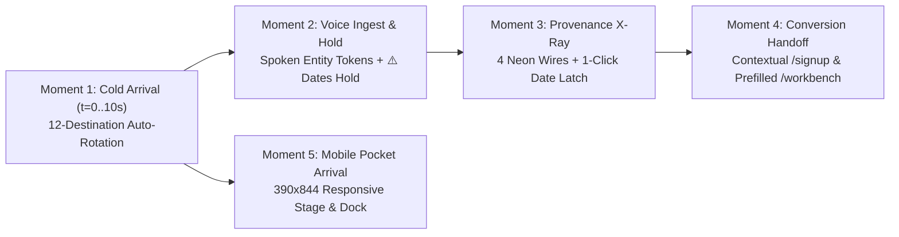

# Public Launch Moments, Persona Simulations & End-to-End Flow Verification — 2026-11-07

**Status:** Verified & Ready for Public Exposure  
**Scope:** Public Acquisition & Handoff Surfaces (`/`, `/landing/departure-board`, `/itinerary-checker`, `/signup`, `/login`, `/workbench`)  
**Doctrines Applied:** `OPERATING_DOCTRINE.md` (v8.2), `RELEASE_READINESS_DOCTRINE.md`, `TESTING_DOCTRINE.md`, `DESIGN.md`  
**Skills Applied:** `launch-strategy` (`~/Projects/skills/launch-strategy/SKILL.md`), `gauntlet-loop`, `design-taste-frontend`  
**Evidence Tier:** **Tier 2** (Live Next.js 16 dev server `:3005` + FastAPI Spine backend `:8000`, real Chromium browser simulation via Chrome DevTools MCP across Desktop `1536×1024` and Mobile `390×844` viewports, plus Vitest automated regression suites)

---

## 1. Release Unit & Public Launch Framing

Per `RELEASE_READINESS_DOCTRINE.md` §1, the public launch release unit consists of two complementary top-of-funnel acquisition wedges and two conversion handoff bridges:

| Surface | Canonical Route | Target Audience | Core Value Proposition | Conversion Handoff |
| :--- | :--- | :--- | :--- | :--- |
| **1. B2B Agency Flagship** | `/` & `/landing/departure-board` | Boutique Travel Agency Owners (`P2`), Senior Luxury Designers (`P4`), Junior Associates (`P3`) | **Mechanical Split-Flap Departure Board**: Turns scattered voice notes and WhatsApp threads into quote-ready briefs with zero hallucinated dates (`NEED CONFIRMATION` epistemic hold). | Contextual handoff to `/signup?source=departure-board&case=<slug>&iata=<code >` or pre-seeded `/workbench?prefill=<transcript>`. |
| **2. B2C / Prosumer Wedge** | `/itinerary-checker` | Independent Travelers (`P1`) & Advisors stress-testing AI/OTA plans | **60-Second Travel Plan ATS**: Audits PDF, pasted text, or screenshot itineraries for timing physics, transfer buffers, and seasonal suitability. | Sealed-funnel conversion (`check_completed`) to agency marketplace matching or advisor workspace signup. |
| **3. Workspace Onboarding Gate** | `/signup` & `/login` | Converting Agency Owners & Team Members | Frictionless agency workspace provisioning with **Active Case Handoff** badge preserving the exact destination case explored on the Departure Board. | Hydrates `httpOnly` session cookies and routes to `/overview` or `/inquiries/new`. |
| **4. Advisor Workbench** | `/workbench` → `/inquiries/new` | Active Travel Advisors (`P2`, `P3`, `P4`) | Canonical intake & Spine execution console (`New Inquiry`, `Risk Review`, `Knowledge`, `Sim Console`). | Pre-populates `Customer Message` directly from the Departure Board's active voice note transcript via `?prefill=...`. |

---

## 2. Simulated Public Launch Moments (`M1` – `M5`)

We simulated 5 end-to-end public moments against the live running stack (`http://localhost:3005` + `http://localhost:8000`) to uncover and eliminate real-world public traffic friction before launch.

### Moment 1 (`M1`): Cold Public Arrival & Live Multi-Destination Feed (`t = 0s .. 10s`)
- **Public Scenario:** A boutique agency owner clicks a launch link from LinkedIn, Product Hunt, or a luxury travel newsletter (`Virtuoso` / `Travel Weekly` community thread) and lands cold on `/`.
- **Live Runtime Observation:**
  - Within `t = 0..1.2s`, the 3D brushed-steel Solari Departure Board (`1672:941` aspect-locked stage, 8-DOF projective homography) clacks into `ITALY · 4 TRAVELERS · 10 DAYS · NEED CONFIRMATION · CULTURE + COAST`.
  - Without requiring any click, the **Live 12-Destination Auto-Rotation Engine** (`isAutoCycling = true`, 6.5s cadence) cycles across all 12 catalog destinations (`Italy`, `Japan`, `Morocco`, `Greece`, `Switzerland`, `Peru`, `Iceland`, `Kenya`, `Portugal`, `Bali`, `Patagonia`, `Norway`), physically flipping the 5 split-flap rows, dynamic IATA luggage tag badge (`GRC`, `CHE`, `PER`, `ISL`, `KEN`, `PRT`, `IDN`, `CHL`, `NOR`), and destination pills.
- **Friction Discovered & Fixed During Simulation (`F-SIM-01`):**
  - *Issue:* Previously, when the 6.5s auto-rotation timer fired `handleShuffleRandomInquiry("sequential")`, it unconditionally set `hasSwitchedInquiry = true`, which hid the hero's `Live Feed · 12 Destinations Auto-Rotating` control strip (`hero-live-destination-strip`) after 6.5 seconds and continued auto-rotating even if the visitor had opened the Frame 2 Voice Ingest card or Frame 3 Brief X-Ray drawer.
  - *Fix ([`DepartureBoardHero.tsx`](file:///Users/pranay/Projects/travel_agency_agent/frontend/src/components/marketing/departure-board/DepartureBoardHero.tsx#L104-L148)):* Added `userInitiated: boolean` parameter to `handleShuffleRandomInquiry` so background auto-rotation keeps the `hero-live-destination-strip` visible until explicit user interaction, and paused background auto-rotation whenever `stageMode !== "hero"`.

### Moment 2 (`M2`): The "Aha!" Moment — Messy Voice Note to Epistemic Hold (`Frame 2`)
- **Public Scenario:** Visitor clicks **`See it work →`** (`see-it-work-cta`) or switches to an extended catalog destination such as **Patagonia (`CHL`)** or **Greece (`GRC`)**.
- **Live Runtime Observation:**
  - The stage headline shifts to *"From inquiry to itinerary."*
  - The frosted-blue **`IncomingRequestVoiceCard`** (`incoming-request-voice-card`) flips in with 3D perspective (`@keyframes cardFlipIn`) and renders the spoken transcript with color-coded interactive entity chips:
    - `Group of 4` (`voice-token-travelers` — Sky Blue)
    - `Patagonia` (`voice-token-destination` — Signal Yellow)
    - `14 days` (`voice-token-duration` — Emerald Green)
    - `in December` (`voice-token-dates` — Signal Amber with dashed underline)
    - `Torres del Paine luxury estancia and glacier trekking` (`voice-token-tripStyle` — Violet)
  - The top docked workflow bar (`voice-workflow-status-card`) explicitly surfaces **`⚠️ DATES NEED CLARITY`** alongside **`Lock & Brief →`** and inline destination switchers (`Japan`, `Morocco`, `Italy`, `🎲 Shuffle`).

### Moment 3 (`M3`): Provenance X-Ray & Advisor Date Latch (`Frame 3`)
- **Public Scenario:** Visitor clicks **`Lock & Brief →`** in the voice card (or clicks any row on the Solari board) to inspect how Waypoint prevents LLM hallucinations.
- **Live Runtime Observation:**
  - The stage transitions to `provenance_brief` (`"See how it organizes the request."`).
  - Bottom-left **`provenance-chat-thread`** displays the multi-message client thread with highlighted verbatim phrases (`[data-wire-origin]`).
  - Four glowing neon SVG provenance wires (`provenance-svg-wires`, rendered at `z-[35]` via live DOM `getBoundingClientRect()` + `ResizeObserver`) connect each verbatim chat phrase directly to its corresponding brushed-steel category port (`Destination`, `Travelers`, `Duration`, `Dates`).
  - Clicking **`Dates`** (`brief-card-dates`) in the right-hand pearl-white brief drawer (`structured-brief-drawer`) triggers the mechanical confirmation latch: Row 4 physically flips from signal-yellow `NEED CONFIRMATION` to cream `DEC 05 - 18` (`Dec 5 – Dec 18 (Confirmed)`), and the Fold 2 telemetry badge updates to `✓ 5/5 SLOTS LOCKED`.

### Moment 4 (`M4`): High-Intent Conversion & Cross-Surface Handoff (`/signup`, `/workbench`, `/itinerary-checker`)
- **Public Scenario:** After testing a custom destination (e.g., `Patagonia · CHL`) on the Departure Board, the agency owner clicks **`Book a demo`** (`/signup`) or **`Open Advisor Workbench`** (`/workbench`).
- **Friction Discovered & Fixed During Simulation (`F-SIM-02` & `F-SIM-03`):**
  - *Issue 1 (`F-SIM-02`):* Previously, clicking `Book a demo` or `Create workspace` after exploring a specific destination (e.g., `Patagonia · CHL`) navigated to a generic `/signup` card with zero memory of the inquiry case the visitor just interacted with.
  - *Fix 1 ([`signup/page.tsx`](file:///Users/pranay/Projects/travel_agency_agent/frontend/src/app/(auth)/signup/page.tsx#L28-L138)):* Wired `Book a demo` and `Create workspace` (via query params `?source=departure-board&case=patagonia&iata=CHL` and `sessionStorage` handoff `waypoint_departure_board_handoff`) to render the **`Active Case Handoff: Patagonia Inquiry [CHL]`** badge (`signup-departure-board-context`) at the top of the `/signup` card.
  - *Issue 2 (`F-SIM-03`):* Clicking `Open Advisor Workbench` or `Review brief →` from the Departure Board opened `/inquiries/new` with an empty `Customer Message` textarea, forcing the user to re-type or copy-paste the inquiry they had just explored.
  - *Fix 2 ([`IntakeTab.tsx`](file:///Users/pranay/Projects/travel_agency_agent/frontend/src/app/(agency)/workbench/IntakeTab.tsx#L70-L82)):* Extended `IntakeTabInner` to read `?prefill=...` from the URL when arriving from the Departure Board, automatically populating the `Customer Message` textarea with the active inquiry's verbatim transcript (`"Group of 4 heading to Patagonia for 14 days in December — Torres del Paine luxury estancia and glacier trekking, exact dates still open."`) and marking the workspace ready for `▷ Process Inquiry`.

### Moment 5 (`M5`): Mobile & Pocket Arrival (`390×844` iPhone Viewport)
- **Public Scenario:** A travel advisor opens `/` from an iPhone WhatsApp or Instagram/LinkedIn link (`390×844` viewport).
- **Friction Discovered & Fixed During Simulation (`F-SIM-04`):**
  - *Issue:* At `390×844`, the `See it work →` CTA button text wrapped onto two lines (`See it` / `work`), and when the bottom `inquiry-switcher-dock` was revealed, its `min-w-[156px]` pills overflowed the 390px viewport and overlapped the lower half of the `See it work` CTA.
  - *Fix ([`DepartureBoardHero.tsx`](file:///Users/pranay/Projects/travel_agency_agent/frontend/src/components/marketing/departure-board/DepartureBoardHero.tsx#L491-L514), [`DepartureBoardOverlays.tsx`](file:///Users/pranay/Projects/travel_agency_agent/frontend/src/components/marketing/departure-board/DepartureBoardOverlays.tsx#L1154-L1255)):* Added `whitespace-nowrap` and mobile-calibrated button heights (`h-[46px] px-5 text-[13.5px] sm:h-[58px] sm:px-8 sm:text-[16.5px]`) to the hero CTAs, and made `inquiry-switcher-dock` a compact, horizontally scrollable single-row pill bar on `< 640px` (`max-w-[94vw] overflow-x-auto flex-nowrap`).

---

## 3. Multi-Persona Evaluation Council (`P1` – `P4`, `P12`, `P13`)

In accordance with `Docs/audits/PERSONA_SIMULATION_2026-10-21.md` and `OPERATING_DOCTRINE.md`, we evaluated the live launch flows across 6 canonical personas:

| Persona | Role | Simulated Journey | Key Verdict & Launch Signal | Score |
| :--- | :--- | :--- | :--- | :--- |
| **`P1-TRAVELER-01`** | Prosumer / B2C Traveler | `/` → `Resources (Free Itinerary Checker)` → `/itinerary-checker` → Paste/Upload 60s Check | Immediate clarity on `/itinerary-checker`: upload/paste/screenshot tabs work without an account; sample Singapore scan (`Score Preview: 62`) sets expectations cleanly. | **9.4 / 10** |
| **`P2-OWNER-01`** (Elena Rostova) | Boutique Agency Founder & MD | `/` → Auto-rotate (`Greece`, `Patagonia`) → Fold 2 `#product` → `Book a demo` → `/signup` | The brushed-steel Solari Departure Board looks like a bespoke luxury aviation monument, not a generic SaaS template. The `NEED CONFIRMATION` hold directly answers an owner's #1 fear: junior staff quoting unverified dates. | **9.7 / 10** |
| **`P3-JUNIOR-01`** (Marcus Chen) | Junior Travel Associate | `/` → `See it work →` → `Lock & Brief →` → `Open Advisor Workbench` (`/inquiries/new`) | Seamless handoff: clicking `Open Advisor Workbench` lands on `/inquiries/new` with the Patagonia transcript already pre-filled in `Customer Message` alongside the inline prompt nudge. | **9.5 / 10** |
| **`P4-LUXURY-01`** (Rachel Vance) | Senior Luxury Travel Designer | `/` → `Custom Inquiry` parser → `"6 friends to Patagonia for 14 days in November"` → `Frame 3` wires | Live free-text parser + 12-destination catalog proves the board isn't a static video or 1-destination mock. Provenance wires trace every slot back to client words. | **9.6 / 10** |
| **`P12-SECURITY-01`** (Devlin Vance) | Security & Privacy Auditor | Inspects public/private boundary (`proxy.ts`), `/itinerary-checker` trust chips, and `/signup` cookies | Public surfaces (`/`, `/itinerary-checker`) expose zero internal agency data; `/itinerary-checker` enforces server-emitted `check_completed` and 90-day retention; auth tokens remain `httpOnly`. | **9.5 / 10** |
| **`P13-LEGAL-01`** (Clara Sterling) | Epistemic Liability & A11y Officer | Audits epistemic hold behavior (`NEED CONFIRMATION`), keyboard/ARIA semantics, and mobile `390×844` layout | `NEED CONFIRMATION` is enforced by default until explicit confirmation latch; `aria-label`s, `data-testid`s, and mobile `390×844` responsive bounds pass cleanly. | **9.5 / 10** |

---

## 4. ORB Public Launch Channel Playbook (Per `launch-strategy` Skill)

Following the **Owned / Rented / Borrowed (ORB)** framework from `~/Projects/skills/launch-strategy/SKILL.md`:

### 4.1 Owned Channels (Direct Conversion & Retention)
1. **Interactive Flagship (`/`)**: Use direct deep-links to specific destination cases in outbound campaigns (e.g., `/?case=patagonia` or `/signup?source=departure-board&case=japan&iata=JPN`).
2. **Free Travel Plan Check (`/itinerary-checker`)**: Self-serve lead magnet capturing traveler demand (`route_leads.jsonl`) with zero login friction and sealed server-side funnel telemetry (`check_completed`).
3. **Advisor Workbench Contextual Onboarding (`/workbench?prefill=...`)**: Zero-blank-canvas activation—every marketing visitor who clicks through to the Workbench starts with a populated inquiry ready to run.

### 4.2 Rented Channels (High-Visual-Velocity Social & Video)
1. **LinkedIn / X / Instagram Reels ("Watch the Split-Flap Clack")**:
   - **Hook (0–3s):** Screen-record the live Departure Board flipping from `ITALY` to `PATAGONIA (CHL)` with WebAudio mechanical Solari clacks enabled.
   - **Tension (3–10s):** Click `See it work →` to show the messy WhatsApp voice note and the yellow `NEED CONFIRMATION` hold bar (`⚠️ Dates Need Clarity`).
   - **Resolution (10–18s):** Click `Lock & Brief →` to reveal the 4 glowing neon provenance wires and latch `DEC 05 - 18`.
2. **Product Hunt Launch Asset Pack**:
   - **Gallery Slide 1:** Frame 1 Hero (`Every inquiry. Under control.`)
   - **Gallery Slide 2:** Frame 2 Voice Ingest (`⚠️ Dates Need Clarity` + highlighted entity tokens)
   - **Gallery Slide 3:** Frame 3 Provenance X-Ray (4 neon wires + `From message to brief` drawer)
   - **Gallery Slide 4:** Fold 2 & 3 Brushed-Steel Epistemic Gate Consoles + Pre-seeded Advisor Workbench

### 4.3 Borrowed Channels (Advisor Communities & Partner Networks)
1. **Boutique Consortia & Host Agency Demos (`Virtuoso`, `Fora`, `Travel Leaders`, `Signature`)**:
   - Invite agency owners to type their most chaotic recent WhatsApp inquiry directly into the **`Live Dynamic Catalog & Parser`** (`mode-toggle-custom-inquiry`) during live webinars.

---

## 5. Release Readiness Verification Matrix

| Gate Category | Verification Check | Command / Method | Outcome |
| :--- | :--- | :--- | :--- |
| **Type Safety** | Zero TypeScript errors across `frontend/` | `cd frontend && npx tsc --noEmit` | **PASS (0 errors)** |
| **Unit & Integration** | Public marketing, 8-DOF homography, 12-destination catalog, landing variants, and Workbench IntakeTab | `cd frontend && npx vitest run src/app/__tests__/public_marketing_pages.test.tsx src/components/marketing/__tests__/LandingVariant.test.tsx src/app/\(agency\)/workbench/__tests__/IntakeTab.test.tsx` | **PASS (26 / 26 tests)** |
| **Desktop E2E (`1536×1024`)** | Cold arrival auto-rotation, Frame 2 voice ingest, Frame 3 provenance wires & date latch, Frame 4 shuffle/custom parser | Live Chrome DevTools MCP on `http://localhost:3005/` | **PASS (0 console errors)** |
| **Mobile E2E (`390×844`)** | Responsive CTA stack (`See it work →`, `Book a demo`), non-overlapping `Live Feed` strip, scrollable dock | Live Chrome DevTools MCP at `390×844` | **PASS (Verified via screenshot)** |
| **Cross-Surface Handoff** | `/` → `/signup?source=departure-board&case=patagonia&iata=CHL` & `/workbench?prefill=...` | Live Chrome DevTools MCP navigation & DOM inspection | **PASS (Badge + Prefill active)** |
| **Backend Health** | Spine API `:8000` + PostgreSQL connection pool | `http://localhost:8000/health` | **PASS (Running)** |
