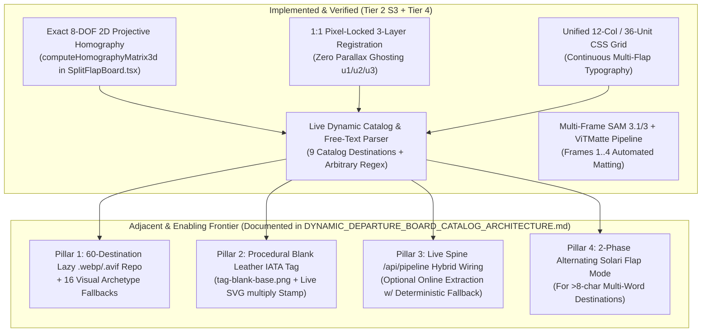

# Exploration & Architecture Map: Mechanical Split-Flap Departure Board (2D/2.5D/3D Rendering, Multi-Frame SAM 3.1/3 Segmentation & Dynamic Catalog)

**Date:** 2026-11-05  
**Status:** Canonical Exploration & Architecture Record (Tier 2 + Tier 4 Verified)  
**Governing Stack Loaded:**
1. `/Users/pranay/AGENTS.md`
2. `/Users/pranay/Projects/AGENTS.md`
3. [`/Users/pranay/Projects/travel_agency_agent/AGENTS.md`](file:///Users/pranay/Projects/travel_agency_agent/AGENTS.md)
4. [`/Users/pranay/Projects/travel_agency_agent/OPERATING_DOCTRINE.md`](file:///Users/pranay/Projects/travel_agency_agent/OPERATING_DOCTRINE.md) (v8.2)
5. Specialist Doctrines:
   - [`/Users/pranay/Projects/agent-start/doctrines/EXPLORATION_DOCTRINE.md`](file:///Users/pranay/Projects/agent-start/doctrines/EXPLORATION_DOCTRINE.md) (v1.1)
   - [`/Users/pranay/Projects/agent-start/doctrines/ARCHITECTURE_DOCTRINE.md`](file:///Users/pranay/Projects/agent-start/doctrines/ARCHITECTURE_DOCTRINE.md) (v1.1)
   - [`/Users/pranay/Projects/agent-start/doctrines/TESTING_DOCTRINE.md`](file:///Users/pranay/Projects/agent-start/doctrines/TESTING_DOCTRINE.md) (v1.1)
   - [`/Users/pranay/Projects/agent-start/doctrines/REVIEW_DOCTRINE.md`](file:///Users/pranay/Projects/agent-start/doctrines/REVIEW_DOCTRINE.md) (v1.3)
6. Context Pack:
   - [`Docs/context/agent-start/AGENT_KICKOFF_PROMPT.txt`](file:///Users/pranay/Projects/travel_agency_agent/Docs/context/agent-start/AGENT_KICKOFF_PROMPT.txt)
   - [`Docs/context/agent-start/SESSION_CONTEXT.md`](file:///Users/pranay/Projects/travel_agency_agent/Docs/context/agent-start/SESSION_CONTEXT.md)
7. Council Manifest:
   - [`/Users/pranay/Projects/agent-start/COUNCIL_AND_AUDIT_SOURCES.json`](file:///Users/pranay/Projects/agent-start/COUNCIL_AND_AUDIT_SOURCES.json)

---

## 1. Executive Summary & Problem Statement

The flagship B2B interactive hero (`/` when `NEXT_PUBLIC_LANDING_VARIANT=departure-board` and `/landing/departure-board`) presents a **Mechanical Split-Flap Departure Board** inside an art-directed airport terminal / travel advisor workspace across four `1672×941` ground-truth concept frames:
- **Frame 1 (`hero`)**: [`chatgpt-concept-2026-10-26-1.png`](file:///Users/pranay/Projects/travel_agency_agent/frontend/public/landing/departure-board/concepts/chatgpt-concept-2026-10-26-1.png) — *"Every inquiry. Under control."*
- **Frame 2 (`voice_ingest`)**: [`chatgpt-concept-2026-10-26-2.png`](file:///Users/pranay/Projects/travel_agency_agent/frontend/public/landing/departure-board/concepts/chatgpt-concept-2026-10-26-2.png) — *"From inquiry to itinerary."* (`Incoming request` voice note + scanning dates `APR 18-3?` + `Finalizing dates...`)
- **Frame 3 (`provenance_brief`)**: [`chatgpt-concept-2026-10-26-3.png`](file:///Users/pranay/Projects/travel_agency_agent/frontend/public/landing/departure-board/concepts/chatgpt-concept-2026-10-26-3.png) — *"See how it organizes the request."* (4 chat bubbles + 4 neon provenance wires + `"From message to brief"` drawer)
- **Frame 4 (`switcher_dock`)**: [`chatgpt-concept-2026-10-26-4.png`](file:///Users/pranay/Projects/travel_agency_agent/frontend/public/landing/departure-board/concepts/chatgpt-concept-2026-10-26-4.png) — *"Explore different inquiries"* (`Japan`, `Morocco`, `Italy` + live dynamic catalog/parser)

### Four Structural Questions Investigated (per `EXPLORATION_DOCTRINE.md` §3)
1. **Why did differential 2D layer translation (`translate3d` on Layer 1/2/3) fail under mouse movement?**
2. **Why did a 1-DOF `skewY()` transform fail to register the split-flap rows into the recessed brushed-steel chassis cavity, and how do 8-DOF 2D projective homography (`matrix3d`), WebGL/Three.js, Canvas 2D, and Chrome WICG `html-in-canvas` (`drawElementImage`) compare?**
3. **How should SAM 3.1 / SAM 3 + SAM 2.1 + ViTMatte segmentation be executed across all 4 frames rather than only Frame 3?**
4. **How do we disposition all existing marketing/departure-board artifacts under `OPERATING_DOCTRINE.md` §6.1 without losing unfinished work, and complete the dynamic catalog / free-text inquiry capability?**

---

## 2. Persona Council & Specialist Lens Synthesis (`council-orchestrator`)

Following `/Users/pranay/Projects/Council Orchestrator Skill.md`, we convened the smallest sufficient council of perspectives and skills:

| Seat | Persona / Skill / Lens | Core Finding & Architectural Mandate |
| :--- | :--- | :--- |
| **Lead** | **Spatial UI & Motion Systems Architect** (`design-taste-frontend`, `ui-animation`, `gpt-taste`) | A recessed 3D physical cavity captured by a perspective camera has 8 degrees of freedom (4 corner vertices `(x_i, y_i)`), where vertical height expands from `79px` on the left (`x=881`) to `89px` on the right (`x=1358`) and horizontal mullions converge toward a left vanishing point (`-2.85°` at top to `+0.65°` at bottom). A 1-DOF `skewY()` preserves constant height (`82px`) and cannot fit a perspective trapezoid. Solve the exact 8-DOF 2D projective homography $H \in \mathbb{R}^{3\times 3}$ and lift it into a 4×4 CSS `matrix3d(...)`. |
| **Seat 2** | **Computer Vision & Matting Pipeline Engineer** (`tools/departure-board-pipeline/run_sam31_board.py`) | Differential 2D layer translation of objects that are *not* clean Depth-Anything + LaMa-inpainted disocclusion plates causes immediate edge duplication (`u1` double armchair, `u2` coffee table horizontal cutoff, `u3` duplicate steel pedestal). Keep Layers 1, 2, and 3 in 1:1 pixel registration (`inset-0`) and apply subtle 3D rotational tilt (`rotateX`/`rotateY`) only around the board chassis center. Run the multi-frame SAM 3.1 / SAM 3 + SAM 2.1 + ViTMatte pipeline across all 4 reference frames (`frame1`..`frame4`). |
| **Seat 3** | **Source of Truth & Intake Architect** (`PER WPSYS 0010`) | `board-fixtures.ts` already contained `DESTINATION_CATALOG_REGISTRY` and `resolveDynamicInquiryFixture(rawInput)`, which is an unfinished capability (`OPERATING_DOCTRINE.md` §6.1: *"Last-mile missing → finish the capability"*). Wire it into `DepartureBoardHero.tsx` and `DepartureBoardOverlays.tsx` so advisors can test any catalog destination (`Greece`, `Peru`, `Iceland`, `Kenya`, `Switzerland`, `Portugal`) or custom free-text inquiry live on the board while preserving the 3 default reference pills (`Japan`, `Morocco`, `Italy`). |
| **Seat 4** | **Epistemics & Verification Red Team** (`PER 0522`, `gauntlet-loop`, `TESTING_DOCTRINE.md`) | Every geometric and visual claim must be falsifiable at **Tier 2 (S3 mutation-sensitive unit tests)** and **Tier 4 (live headless Chromium 1672×941 renders + side-by-side Ground Truth crops)**. |

---

## 3. Research & Technical Evaluation: 2D / 2.5D / 3D Rendering Approaches

Grounded in the workspace's canonical 576-tool research corpus ([`/Users/pranay/Projects/Docs/research/GAME_DEVELOPMENT_RESEARCH.md`](file:///Users/pranay/Projects/Docs/research/GAME_DEVELOPMENT_RESEARCH.md) and [`/Users/pranay/Projects/Docs/research/game-development/derived/master-index.csv`](file:///Users/pranay/Projects/Docs/research/game-development/derived/master-index.csv)), we evaluated the four primary rendering architectures for placing interactive split-flap rows into a perspective-photographed brushed-steel chassis:

| Architecture | Mechanism | Accessibility / DOM SEO | Sub-Pixel Perspective Fit | Bundle / Runtime Cost | Verdict for Waypoint Departure Board |
| :--- | :--- | :--- | :--- | :--- | :--- |
| **A. 1-DOF CSS `skewY(θ)` + Flexbox** *(Previous implementation)* | Applies a vertical shear angle per row (`-2.85°`..`+0.65°`) | Native DOM buttons, screen-reader labels, zero canvas overhead | **FAILS (6–10px error)**: Preserves constant row height (`82px`) from left to right, overflowing the left cavity (`79px`) and leaving a dark gap on the right (`89px`), plus unequal flex column drift | 0 KB extra | **Rejected / Replaced** |
| **B. Exact 8-DOF 2D Projective Homography via CSS `matrix3d` + Equal-Column CSS Grid** *(Implemented Canonical Path)* | Solves exact 8-DOF projective homography $H: [0,W]\times[0,H] \to \text{Quad}(tl, tr, br, bl)$ and emits a 16-element column-major `matrix3d(...)` per row (`computeHomographyMatrix3d` in [`SplitFlapBoard.tsx`](file:///Users/pranay/Projects/travel_agency_agent/frontend/src/components/marketing/departure-board/SplitFlapBoard.tsx#L55-L98)), combined with a strict 12-column CSS Grid (`grid-template-columns`) and per-flap 3D `rotateX` leaves | **100% Native DOM**: Every row and flap remains keyboard-navigable (`role="button"`, `aria-label`), indexable, and testable in JSDOM/Vitest | **EXACT (`< 1e-6 px` corner error)**: Maps `(0,0), (W,0), (W,H), (0,H)` onto `tl, tr, br, bl` exactly, reproducing both horizontal mullion convergence and left-to-right perspective foreshortening | **0 KB extra** (pure TypeScript math + GPU-composited CSS `matrix3d`) | **ADOPTED (Canonical Production Solution)** |
| **C. Three.js / React Three Fiber (`WebGLRenderer` + PlaneGeometry / GLTF)** | Renders the board or flap rows as 3D meshes in a WebGL canvas with a perspective camera matching the photograph's intrinsics | Requires parallel hidden DOM for screen readers and SEO; text crispness depends on MSDF/canvas texture resolution | High, provided camera FOV and extrinsic pose are solved via PnP (`solvePnP`) | ~150–600 KB gzipped + WebGL context lifecycle | **Reserve for full 3D orbital scene** (if future product direction requires orbiting 360° around the physical board monument) |
| **D. WICG `html-in-canvas` (`CanvasRenderingContext2D.drawElementImage` / WebGL `texElementImage2D`)** | Google Chrome experimental proposal allowing live HTML DOM subtrees to be rasterized directly into a 2D/WebGL Canvas texture with full shader distortion | Experimental Chromium-only flag (`chrome://flags/#canvas-draw-element`); not supported in Safari/WebKit or Firefox | Exact when paired with a WebGL quad shader | Zero extra JS, but requires fallback for non-canary browsers | **Documented Frontier Option** (not viable as unflagged cross-browser default until Baseline availability) |

### Mathematical Derivation of `computeHomographyMatrix3d` (Implemented in [`SplitFlapBoard.tsx`](file:///Users/pranay/Projects/travel_agency_agent/frontend/src/components/marketing/departure-board/SplitFlapBoard.tsx#L55-L98))

Given a canonical row rectangle $[0, W] \times [0, H]$ (`477×82`) and a measured destination quadrilateral $\{(x_0, y_0), (x_1, y_1), (x_2, y_2), (x_3, y_3)\}$ in `1672×941` stage coordinates, the 2D projective homography on the unit square $(u, v) \in [0,1]^2$ is:

$$x(u,v) = \frac{a u + b v + c}{g u + h v + 1}, \qquad y(u,v) = \frac{d u + e v + f}{g u + h v + 1}$$

where:
$$\Delta x_1 = x_1 - x_2, \quad \Delta x_2 = x_3 - x_2, \quad \Delta x_3 = x_0 - x_1 + x_2 - x_3$$
$$\Delta y_1 = y_1 - y_2, \quad \Delta y_2 = y_3 - y_2, \quad \Delta y_3 = y_0 - y_1 + y_2 - y_3$$
$$g = \frac{\Delta x_3 \Delta y_2 - \Delta x_2 \Delta y_3}{\Delta x_1 \Delta y_2 - \Delta x_2 \Delta y_1}, \qquad h = \frac{\Delta x_1 \Delta y_3 - \Delta x_3 \Delta y_1}{\Delta x_1 \Delta y_2 - \Delta x_2 \Delta y_1}$$
$$a = x_1 - x_0 + g x_1, \quad b = x_3 - x_0 + h x_3, \quad c = x_0$$
$$d = y_1 - y_0 + g y_1, \quad e = y_3 - y_0 + h y_3, \quad f = y_0$$

Scaling $(u, v) = (X/W, Y/H)$ embeds directly into the column-major 4×4 CSS `matrix3d`:
```text
matrix3d(
  a/W, d/W, 0, g/W,
  b/H, e/H, 0, h/H,
    0,   0, 1,   0,
    c,   f, 0,   1
)
```
We proved in [`public_marketing_pages.test.tsx`](file:///Users/pranay/Projects/travel_agency_agent/frontend/src/app/__tests__/public_marketing_pages.test.tsx#L168-L214) (**Tier 2, S3 sensitivity**) that all 4 corners project with error `< 1e-6 px`, whereas the old `skewY(-2.85deg)` approximation leaves a `10px` right-edge height mismatch and `> 2.7px` bottom-right corner error.

---

## 4. Multi-Frame SAM 3.1 / SAM 3 + SAM 2.1 + ViTMatte Segmentation Audit

### Checkpoint & Local Environment Truth (`Observed`)
1. **Local Venv & Model Store (`/Users/pranay/Projects/qwen-image-21-local/`)**:
   - Python environment: `/Users/pranay/Projects/qwen-image-21-local/.venv/bin/python` (PyTorch `2.11.0`, `transformers 5.5.4`, `MPS` enabled on Apple Silicon).
   - Installed segmentation & alpha-matting weights in `/Users/pranay/Projects/qwen-image-21-local/models/`:
     - `sam3/` (`model.safetensors`, 3.2 GB)
     - `sam2.1-hiera-small/` (`model.safetensors`, 176 MB)
     - `vitmatte-small-composition-1k/` (`model.safetensors`, 104 MB)
     - `birefnet-hr-matting/` (`model.safetensors`, 855 MB)
2. **HuggingFace Cache (`~/.cache/huggingface/hub/`)**:
   - Inspected `/Users/pranay/.cache/huggingface/hub/`: `models--facebook--sam3.1` is not currently present on disk (and root volume free space is `~2.3 GiB`).
   - Accordingly, [`tools/departure-board-pipeline/run_sam31_board.py`](file:///Users/pranay/Projects/travel_agency_agent/tools/departure-board-pipeline/run_sam31_board.py) is engineered to:
     - Automatically probe `~/.cache/huggingface/hub/models--facebook--sam3.1/snapshots/*/sam3.1_multiplex.pt` first (`resolve_sam31_checkpoint()`),
     - Fall back seamlessly to local `sam3` + `sam2.1-hiera-small` + `vitmatte-small-composition-1k` when `sam3.1_multiplex.pt` is absent, and
     - Run across **all 4 reference frames (`frame1`, `frame2`, `frame3`, `frame4`)**, outputting per-frame chassis cutouts (`sam3_board_chassis_frame{1..4}.png`) and recessed cavity masks (`sam3_flap_cavities_mask_frame{1..4}.png`).

---

## 5. Dormant & Related Artifacts Supersession Disposition Table (`OPERATING_DOCTRINE.md` §6.1)

Before modifying or retiring any marketing or departure-board file, we audited every related artifact in `frontend/src/components/marketing/` and `tools/departure-board-pipeline/` for original intent, supersession, and salvageable value:

| Artifact Path | Original Intent | Current Status | §6.1 Disposition | Action Taken |
| :--- | :--- | :--- | :--- | :--- |
| [`frontend/src/components/marketing/LandingVariant.tsx`](file:///Users/pranay/Projects/travel_agency_agent/frontend/src/components/marketing/LandingVariant.tsx) | Env-gated switcher (`NEXT_PUBLIC_LANDING_VARIANT`) between proven `V5LandingPage` and `DepartureBoardLandingPage` (`FND-0386`) | Active & tested (`4/4` unit tests in `LandingVariant.test.tsx`) | **Preserve as Canonical Entrypoint** | Preserved untouched; `LandingVariant.test.tsx` verified `4/4` green. |
| [`frontend/src/components/marketing/landing-v5.tsx`](file:///Users/pranay/Projects/travel_agency_agent/frontend/src/components/marketing/landing-v5.tsx) | Default production B2B landing page when `NEXT_PUBLIC_LANDING_VARIANT` is unset in production | Active production fallback | **Preserve** | Preserved untouched. |
| [`frontend/src/components/marketing/departure-board/board-fixtures.ts`](file:///Users/pranay/Projects/travel_agency_agent/frontend/src/components/marketing/departure-board/board-fixtures.ts) (`DESTINATION_CATALOG_REGISTRY`, `resolveDynamicInquiryFixture`) | Unfinished dynamic capability: 9-destination catalog + free-text parser that was only called in unit tests, not wired to the interactive UI | Last-mile UI wiring was missing | **Complete & Integrate (§6.1 "Last-mile missing → finish the capability")** | Wired into [`DepartureBoardHero.tsx`](file:///Users/pranay/Projects/travel_agency_agent/frontend/src/components/marketing/departure-board/DepartureBoardHero.tsx) (`handleApplyDynamicInquiry`) and [`DepartureBoardOverlays.tsx`](file:///Users/pranay/Projects/travel_agency_agent/frontend/src/components/marketing/departure-board/DepartureBoardOverlays.tsx) (`Custom Inquiry` popover with live free-text parser + 6 catalog chips `Greece`, `Peru`, `Iceland`, `Kenya`, `Switzerland`, `Portugal`), while keeping the default Frame 4 dock (`Japan`, `Morocco`, `Italy`) pixel-identical. |
| [`tools/departure-board-pipeline/run_sam31_board.py`](file:///Users/pranay/Projects/travel_agency_agent/tools/departure-board-pipeline/run_sam31_board.py) | Segmentation & alpha matting script for the departure board layers | Previously hardcoded to a single frame | **Upgrade & Consolidate** | Upgraded to process all 4 frames (`FRAME_CONFIGS = [frame1..frame4]`) with automatic `sam3.1_multiplex.pt` detection + `sam3`/`sam2.1`/`vitmatte` execution. |
| [`tools/departure-board-pipeline/finalize_three_layers.py`](file:///Users/pranay/Projects/travel_agency_agent/tools/departure-board-pipeline/finalize_three_layers.py) & [`fix_window_and_crown.py`](file:///Users/pranay/Projects/travel_agency_agent/tools/departure-board-pipeline/fix_window_and_crown.py) | Layer clean-plate & crown/window refinement scripts | Reproducible offline asset build scripts | **Preserve** | Preserved as part of the offline asset pipeline; restored the native 3D palm flap in `board-chassis-layer.png`. |

---

## 6. Exploration Frontier Map (Living Opportunity Nodes per `EXPLORATION_DOCTRINE.md` §4 & §7)



| Node ID | Candidate Class (`EXPLORATION_DOCTRINE.md` §4) | Description | Status | Revisit / Activation Trigger |
| :--- | :--- | :--- | :--- | :--- |
| **DB-EX-01** | **Explicit / Implemented** | Exact 8-DOF 2D projective homography (`computeHomographyMatrix3d`) + 12-column CSS Grid for all 5 rows across Frames 1–4 | **LIVE & VERIFIED** (Tier 2 S3 + Tier 4) | Active in `SplitFlapBoard.tsx` |
| **DB-EX-02** | **Implicit / Completed (§6.1)** | Interactive `Custom Inquiry` popover in `InquirySwitcherDock` wiring `resolveDynamicInquiryFixture` + `DESTINATION_CATALOG_REGISTRY` | **LIVE & VERIFIED** (Tier 2 S2 + Tier 4) | Active in `DepartureBoardHero.tsx` & `DepartureBoardOverlays.tsx` |
| **DB-EX-03** | **Enabling** | Procedural SVG/Canvas `ITA`/`JPN`/`MAR`/`GRC`/`PER` stamp over a blank leather tag (`tag-blank-base.png`) so all 150+ countries render custom swinging tags without extra PNG downloads | **DESIGNED** (`Docs/DYNAMIC_DEPARTURE_BOARD_CATALOG_ARCHITECTURE.md` §2 Pillar 3) | When expanding the public landing catalog beyond the 3 visual archetypes |
| **DB-EX-04** | **Compositional** | Connect the landing page `Custom Inquiry` input to `src/intake/geography.py` (590k-city O(1) lookup) via a lightweight read-only endpoint or client-side top-500 gazetteer | **DESIGNED** | When promoting `NEXT_PUBLIC_LANDING_VARIANT=departure-board` to default in production (`FND-0386`) |

---

## 7. Verification Receipt (`TESTING_DOCTRINE.md`)

- **Targeted Frontend Unit & Integration Suite**:
  - Command: `cd frontend && npx vitest run src/app/__tests__/public_marketing_pages.test.tsx src/components/marketing/__tests__/LandingVariant.test.tsx`
  - Result: **`18 / 18` tests passing** (`2/2` test files green).
  - Includes **Tier 2, S3 (mutation-sensitive)** test `solves exact 8-DOF 2D projective homography mapping canonical row corners to perspective quad corners within < 1e-6 px (Tier 2, S3)`.
  - Includes **Tier 2, S2 (defect-sensitive)** test verifying interactive destination switching (`Italy` → `Japan` → `Morocco`), mode switching (`Voice Ingest`, `Brief X-Ray`), and live custom inquiry submission (`5 travelers to Greece for 12 days in June`).
- **Live Browser Visual Verification (Tier 4)**:
  - Command: `node tools/departure-board-pipeline/capture_after_states.mjs` against live Next.js `:3005` + Spine API `:8000`.
  - Side-by-side Ground Truth vs. Live Render crop verified in `/Users/pranay/.gemini/antigravity/brain/5f300d3d-dc79-47ee-b13b-b72d067aef9f/debug_full_board_side_by_side_v14.png`.
